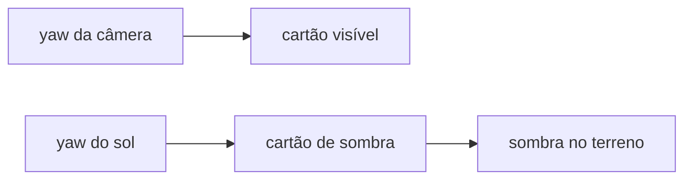

# Billboards no 3D

Sprites no modo 3D não são malha com volume. São cartões com o PNG do 2D. Há dois usos, com regras diferentes.

| | Props (árvore, mata, grama, pedra, cristal) | Personagem e agente |
|---|---|---|
| Arquivo | [`js/render/3d/vegetacaoBillboard3d.js`](../js/render/3d/vegetacaoBillboard3d.js) | [`js/render/3d/personagem3d.js`](../js/render/3d/personagem3d.js) |
| Objeto | `InstancedMesh` (um lote por sprite) | `THREE.Sprite` (um por corpo) |
| Para quem olha | Só o yaw da câmera. O pitch não deita o cartão | Câmera inteira (o `Sprite` do Three) |
| Sombra no chão | Outro cartão, virado para o sol | Elipse de contato, não o sprite |
| Cor | Luz da cena, com a normal trocada para o sol | `SpriteMaterial` sem luz; a cor é pintada na CPU |

Placa não entra nesse caminho. Continua mesh em [`terrenoMalha.js`](../js/render/3d/terrenoMalha.js).

## Ordem no frame

Em [`cenario3d.js`](../js/render/3d/cenario3d.js), `atualizarEDesenhar3d`:

1. A câmera segue o corpo.
2. `ceu.atualizar` posiciona sol, fill, rim, ambiente e hemisfério, e chama `atualizarLuzBillboard`.
3. `vegetacao.atualizar(yaw)` gira o cartão visível para a câmera e o cartão de sombra para o sol.
4. `personagem.atualizar` / `agente` aplicam a cor do sol no sprite.
5. O renderer desenha.

A luz tem de ser atualizada antes dos sprites. Se inverter, a cor fica um frame atrasada.

## Props

### De onde vêm

`recolherGrupos` junta `PROPS` do demo e a vegetação de bioma (`todaVegetacao`). A chave do lote é `prop.sprite`, ou o `tipo` se não houver sprite. Cada chave vira um `InstancedMesh` com no máximo 4096 instâncias. Um draw call por sprite, não por planta.

O quad é um `PlaneGeometry(1, 1)` com o pivô no pé (`translate(0, 0.5, 0)`). A escala da instância é o tamanho em células:

```
largura = (px de largura / TILE) × escala
altura  = (px de altura  / TILE) × escala
```

| Tipo | Escala | Pé (afunda no chão) |
|---|---|---|
| `arvore` | `VEG_ARVORE_ESCALA` (1) | `VEG_ARVORE_PE` (2/TILE) |
| `mata`, `grama` e o resto | `VEG_MATA_ESCALA` (0.75) | `VEG_MATA_PE` (1/TILE) |
| `pedra`, `cristal` | 1 | `VEG_MATA_PE` |

A altura do pé é `alturaEm` da célula vezes `ALTURA_BLOCO`. O 2D usa a mesma escala de mata (`VEG_MATA_ESCALA`) em `terreno.js` e no fade de cobertura.

A textura é o PNG do atlas, `NearestFilter`, sem mipmap. `alphaTest` (`VEG_ALPHA_TEST`, 0.12) recorta o transparente no passe opaco. Sem atlas, o lote não é criado.

As matrizes só são reescritas se o yaw da câmera ou o yaw do sol mudou mais que `VEG_YAW_EPS` (0.001 rad), ou se o mundo sujou (`onDirty`) e a altura do chão pode ter mudado.

### Dois cartões

O mesmo lote tem duas malhas. Girar os dois juntos faria a sombra no terreno acompanhar a câmera. Não é o que se quer.



**Visível** (`veg-<sprite>`): yaw da câmera, `castShadow = false`. `MeshStandardMaterial` com a textura. O pé fica no chão em qualquer pitch porque só o Y gira.

`PlaneGeometry` nasce olhando para +Z. `rotation.y = yaw` da câmera aponta essa face para a câmera: o yaw 0 da câmera deixa o olho em +Z.

**Sombra** (`veg-sombra-<sprite>`): mesma posição e escala, yaw de `yawCartaoSol()`. `castShadow = true`. No passe de cor não aparece (`colorWrite` e `depthWrite` desligados). `frustumCulled = false` porque o volume das instâncias não pode ser o quad unitário na origem — isso cullava o lote inteiro e a sombra sumia.

`yawCartaoSol` é `atan2(direçãoDaLuz.x, direçãoDaLuz.z)`. A direção é sol (ou lua, à noite) menos o alvo, a mesma usada para posicionar a `DirectionalLight`. O plano fica de frente para a luz, como se a câmera estivesse olhando para o sol. Orbitar o personagem não gira essa sombra.

O Three, por padrão, rasteriza no shadow map a face de trás (`shadowSide` de um material `FrontSide` vira `BackSide`). Um cartão de frente para o sol mostra a face da frente para a luz, e a sombra não saía. Por isso `shadowSide = DoubleSide`. O recorte usa a mesma textura e o mesmo `alphaTest`, num `MeshDepthMaterial` em `customDepthMaterial`. O `getDepthMaterial` do Three ainda copia `map` e `alphaTest` do material de cor por cima do depth material — os dois precisam ter a textura.

## Cor, sem depender da câmera

Arquivo: [`js/render/3d/ceu/luzBillboard.js`](../js/render/3d/ceu/luzBillboard.js).

Um cartão que gira com a câmera muda a normal geométrica. `MeshStandardMaterial` escurece e clareia conforme essa normal pega o sol. A cor tem de ser a de um cartão virado para a luz daquele instante.

`aplicarLuzBillboard` troca, no fragment shader, a normal de iluminação por `uNormalSol` (direção da luz, em view space). Não mexe na geometria nem no depth da sombra. `roughness = 1` e `metalness = 0` para o brilho especular não mudar com o ângulo da câmera. `aplicarSombraNuvem` continua multiplicando o difuso pela sombra da nuvem.

`atualizarLuzBillboard` roda no fim de `aplicarLuzes` em [`ceu.js`](../js/render/3d/ceu/ceu.js). Guarda a direção do sol e a irradiância (ambiente + hemisfério + sol com N·L = 1 + fill e rim), dividida por π, no mesmo peso do Lambert do Three.

O personagem não usa esse shader. `SpriteMaterial` não recebe luz de cena. `aplicarCorSprite` pinta `material.color` com essa irradiância, a tinta base (o agente é azulado) e o fator de nuvem em `(x, altura, z)`. A sombra direta da nuvem pesa 1. A indireta pesa 0.42, igual ao shader do terreno.

## Personagem

`THREE.Sprite` com pivô no pé (`center` 0.5, 0) e altura 1.25. O sheet de 64×64 é copiado para um canvas por frame (linha = facing relativo à câmera, coluna = passo da animação). `castShadow` fica desligado. A sombra no chão é a elipse de [`sombraContato3d.js`](../js/render/3d/sombraContato3d.js), não a silhueta do sprite. Debaixo d'água, um segundo sprite faz o véu, cortado por um plano na superfície.
